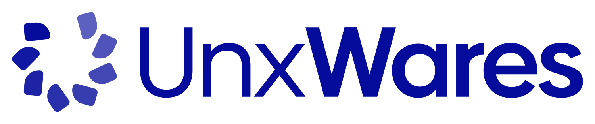

  

# 
Hi there 👋, we are UnxWares
  

🇫🇷 Nous sommes une entreprise Française de développement et d'hébergement informatique
 
🇺🇸 We are a French IT development and hosting company  

# 💫 À propos de nous / About us:

- 🔭 🇫🇷 Nous travaillons actuellement sur la création de notre [site web](https://www.unxwares.com)
   
  🔭 🇺🇸 We're currently working on the creation of our [website](https://www.unxwares.com)  
  

- 🌱 🇫🇷 Nous travaillons pour proposer des solutions informatiques écoresponsables, avec un programme de protection de l'environnement
   
  🌱 🇺🇸 We are working to offer eco-responsible IT solutions, with an environment protect programme  
  

- 🤝 🇫🇷 Nos projets open source font partie d'**UnxWares Open Source & Community** (UWOSC), le travail open source que nous soutenons et maintenons, comme nos [charts Helm](https://github.com/UnxWares/helm)
   
  🤝 🇺🇸 Our open source projects are part of **UnxWares Open Source & Community** (UWOSC), the open source work we support and maintain, such as our [Helm charts](https://github.com/UnxWares/helm)
   
  <picture><source media="(prefers-color-scheme: dark)" srcset="https://helm.unxwares.studio/assets/uwosc/badge-maintained-dark.svg"></picture>
  

- ⚡🇫🇷 Retrouvez nous sur [https://www.unxwares.com](https://www.unxwares.com) et sur nos réseaux
   
  ⚡🇺🇸 Follow us on [https://www.unxwares.com](https://www.unxwares.com) and on our social networks  
  

   
